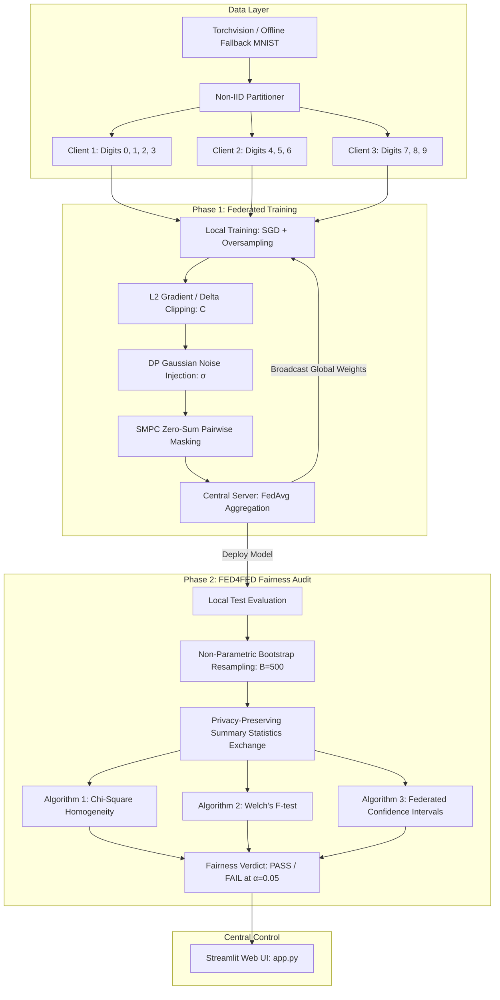

# Federated MNIST & FED4FED Fairness Evaluation System

A modular, production-ready Python project that implements a privacy-preserving Federated Learning (FL) pipeline and a post-convergence Fairness Evaluation framework (**FED4FED**) using strictly the **MNIST** benchmark dataset and a PyTorch Convolutional Neural Network (CNN), complete with a centralized **Streamlit Web UI Dashboard**.

---

## 🏛️ Project Architecture & Pipeline



---

## 📁 Directory Structure

```text
federated_mnist_project/
│
├── data/
│   ├── __init__.py
│   ├── mnist_loader.py             # Automatic torchvision MNIST downloader & offline synthetic fallback
│   └── partitioned_clients/        # Non-IID label skew partitioner (Client 1, 2, and 3)
│       ├── __init__.py
│       └── partitioner.py
│
├── phase1_training/
│   ├── __init__.py
│   ├── model.py                    # PyTorch CNN (2 Conv + MaxPool + Dense layers to 10 classes)
│   ├── client.py                   # Local training, oversampling, gradient clipping & DP noise injection
│   ├── server.py                   # Secure global aggregation (FedAvg) and model broadcasting
│   └── train_fl.py                 # Multi-round orchestration script
│
├── phase2_evaluation/
│   ├── __init__.py
│   ├── bootstrap.py                # Non-parametric bootstrap resampling for local client evaluations
│   ├── fed4fed_algorithms.py       # Algorithm 1 (Chi-square), Algorithm 2 (Welch's F), Algorithm 3 (CIs)
│   └── evaluate_fairness.py        # Fairness audit script against significance level alpha = 0.05
│
├── utils/
│   ├── __init__.py
│   ├── metrics.py                  # Computes Accuracy, Precision, Recall, F1-score, and ROC-AUC
│   └── crypto_utils.py             # SMPC additive masking and SHA-256 parameter integrity verification
│
├── app.py                          # Streamlit Web UI Dashboard (Central Server Admin Control Panel)
├── requirements.txt                # Dependencies (torch, torchvision, streamlit, pandas, numpy, scikit-learn, scipy)
└── README.md                       # Comprehensive guide on installation, backend execution, and UI
```

---

## 🔬 Mathematical Formulations

### 1. Differential Privacy & Gradient Clipping (DP-FedAvg)
For client $k$ starting from global parameter state $w^{(t)}$:
1. **Local Parameter Delta**:
   $$\Delta w_k = w_k^{(t)} - w^{(t)}$$
2. **$L_2$ Model Update Clipping**:
   $$\Delta \tilde{w}_k = \Delta w_k \cdot \min\left(1, \frac{C}{\|\Delta w_k\|_2}\right)$$
3. **Calibrated DP Gaussian Noise Perturbation**:
   $$\tilde{w}_k = w^{(t)} + \Delta \tilde{w}_k + \mathcal{N}\left(0, \sigma^2 C^2 \mathbf{I}\right)$$

### 2. Secure Aggregation via Zero-Sum Pairwise Masking (SMPC)
Clients generate symmetric random masks $r_{u,v} = -r_{v,u}$ such that $\sum_{u=1}^K m_u = \mathbf{0}$. The central server aggregates:
$$w^{(t+1)} = \sum_{u=1}^K \frac{n_u}{n_{total}} (\tilde{w}_u + m_u) = \sum_{u=1}^K \frac{n_u}{n_{total}} \tilde{w}_u$$

### 3. FED4FED Statistical Fairness Framework
- **Algorithm 1: Graybill-Deal Consensus & Chi-Square Homogeneity Test**:
  Tests $H_0: \theta_1 = \dots = \theta_K$ against $H_1:$ at least two nodes differ.
  $$w_k = \frac{1/s_k^2}{\sum_j 1/s_j^2}, \quad \hat{\theta}_{GD} = \sum_{k=1}^K w_k \hat{\theta}_k$$
  $$\chi^2 = \sum_{k=1}^K \frac{(\hat{\theta}_k - \hat{\theta}_{GD})^2}{s_k^2}, \quad df = K - 1$$
- **Algorithm 2: Welch's F-Test (Heteroscedastic ANOVA)**:
  Tests equality of group means without assuming equal variances:
  $$w_k = \frac{n_k}{s_k^2}, \quad \bar{x}' = \frac{\sum w_k \bar{x}_k}{\sum w_k}$$
  $$F = \frac{\frac{1}{K-1} \sum w_k (\bar{x}_k - \bar{x}')^2}{1 + \frac{2(K-2)}{K^2-1} \sum \frac{(1 - w_k / W)^2}{n_k - 1}}$$
- **Algorithm 3: Federated Confidence Intervals & Pairwise Disparity**:
  Computes local Student's t confidence intervals, Graybill-Deal consensus confidence intervals with Welch-Satterthwaite effective degrees of freedom, and pairwise difference confidence intervals:
  $$\Delta_{ij} = \bar{x}_i - \bar{x}_j, \quad CI = \left[\Delta_{ij} \pm t_{crit} \sqrt{\frac{s_i^2}{n_i} + \frac{s_j^2}{n_j}}\right]$$
  adjusted by Bonferroni multi-testing threshold $\alpha_{bonf} = \alpha / \binom{K}{2}$. Disparity is declared if 0 is outside the interval.

---

## ⚡ Installation & Setup

### 1. Clone or Navigate to the Project
```bash
cd C:\Users\anish\.gemini\antigravity\scratch\federated_mnist_project
```

### 2. Install Dependencies
```bash
pip install -r requirements.txt
```

---

## 🚀 Execution Guide

### Option A: Launch Streamlit Web UI Dashboard
```bash
streamlit run app.py
```
Open `http://localhost:8501` in your browser. From the dashboard:
- Adjust FL communication rounds, local epochs, and learning rates.
- Fine-tune DP Gaussian noise $\sigma$ and clipping bound $C$.
- View real-time loss and accuracy curves per round.
- Run post-training FED4FED statistical fairness audits and inspect p-values.
- Inspect client confusion matrices, ROC-AUC metrics, and SMPC zero-sum mask cancellations.

---

### Option B: Run Federated Training via CLI
```bash
python phase1_training/train_fl.py --rounds 5 --epochs 1 --batch-size 64 --lr 0.01 --sigma 0.05 --clip-c 1.0
```
This orchestrates 5 rounds of DP-FedAvg training across the 3 non-IID clients and saves the trained global model to `phase1_training/global_model.pt`.

---

### Option C: Run Fairness Audit via CLI
```bash
python phase2_evaluation/evaluate_fairness.py --model-path phase1_training/global_model.pt --alpha 0.05 --bootstrap 500
```
This deploys the global model back to clients, computes non-parametric bootstrap distributions, and runs Algorithms 1, 2, and 3, outputting a complete terminal audit table.

---

## 🧪 Verification & Automated Testing

To verify all components end-to-end:
```bash
# 1. Verify module imports
python -c "import data, phase1_training, phase2_evaluation, utils; print('All modules imported successfully!')"

# 2. Test quick 2-round training loop
python phase1_training/train_fl.py --rounds 2 --epochs 1

# 3. Test fairness evaluation
python phase2_evaluation/evaluate_fairness.py --bootstrap 200
```
